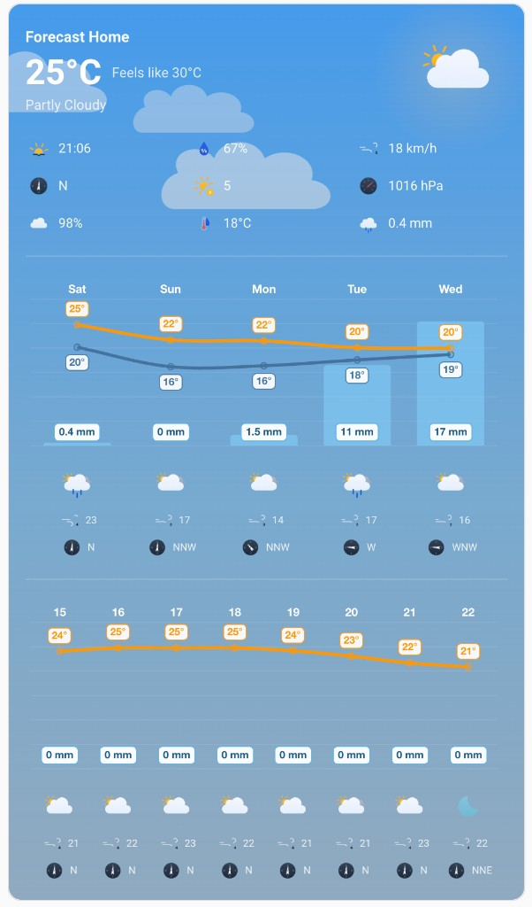
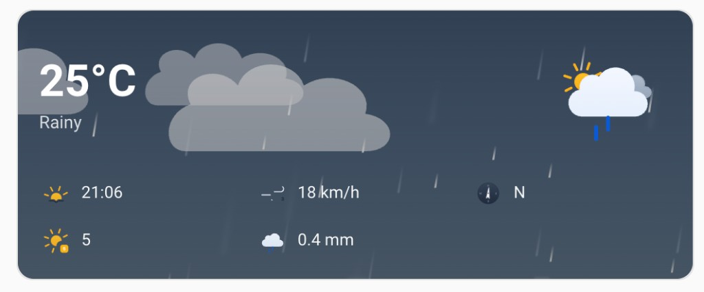
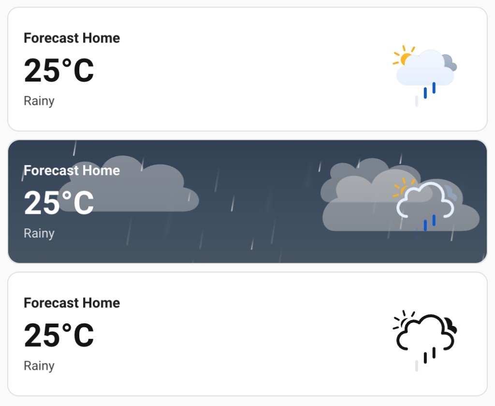
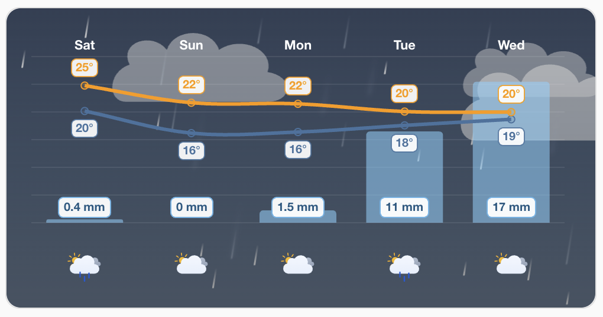
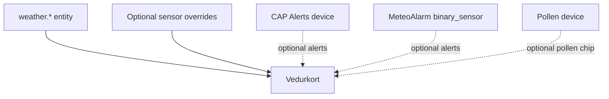

# Veðurkort Weather Card

**Veðurkort** is Icelandic for “weather card” / “weather map”. Pronounced roughly *VEH-thur-kort* (ð like the *th* in *weather*).

Home Assistant Lovelace weather card with **[Meteocons](https://meteocons.com/)** icons, optional CSS weather backgrounds, and Chart.js daily/hourly forecasts.

**Custom type:** `custom:vedurkort-weather-card`

| Full | Current | Icon styles | Daily only |
| --- | --- | --- | --- |
|  |  |  |  |

## Features

- Compose sections independently: current weather, daily forecast, hourly forecast (any combination)
- **Meteocons** — styles `fill` / `flat` / `line` / `monochrome`, animated or static
- Day/night condition icons; cloudy / precip / storm icons follow `cloud_coverage`
- Optional CSS animated backgrounds
- Detail chips (sun, humidity, wind, UV, pressure, and more) with tap-to-open detail sheets
- Layout presets: `default`, `compact`, or `minimal`
- Full visual editor — configure everything in the UI, no YAML required
- Optional **weather alerts** via [CAP Alerts](https://github.com/seevee/cap_alerts) or core [MeteoAlarm](https://www.home-assistant.io/integrations/meteoalarm/)
- Optional **pollen** chip via companion [Pollen](https://github.com/tempi-marathon/ha-pollen) (Europe / CAMS)
- Localized UI (`en`, `nl`, `is`) — see [7. Localization](docs/07-localization.md)

## Ecosystem

Veðurkort reads Home Assistant entities — it does not call weather/alert/pollen APIs itself.

## Install

**Home Assistant 2023.9+** recommended for live forecasts (`weather/subscribe_forecast`).

1. Open HACS → search for **Veðurkort Weather Card**, or use the button above
2. Download / install the card
3. Reload the browser (or refresh Lovelace resources), then **Add card** and search for **Veðurkort**

On **Home Assistant 2026.11+**, install from **Settings → Marketplace**; the same button opens Marketplace after you upgrade.

Full guide (including resource paths): [1. Installation](docs/01-installation.md)

## Documentation

[1. Installation](docs/01-installation.md) ·
[2. Configuration](docs/02-configuration.md) ·
[3. Usage](docs/03-usage.md) ·
[4. Weather alerts](docs/04-alerts.md) ·
[5. Pollen](docs/05-pollen.md) ·
[6. Examples](docs/06-examples.md) ·
[7. Localization](docs/07-localization.md) ·
[8. Credits](docs/08-credits.md)

Development: [CONTRIBUTING.md](CONTRIBUTING.md)

## License

MIT — see [LICENSE](LICENSE).

Meteocons icons are MIT licensed — copyright © Bas Milius. See [NOTICE](NOTICE), [meteocons.com](https://meteocons.com/), and the [Meteocons LICENSE](https://github.com/basmilius/meteocons/blob/main/LICENSE).
